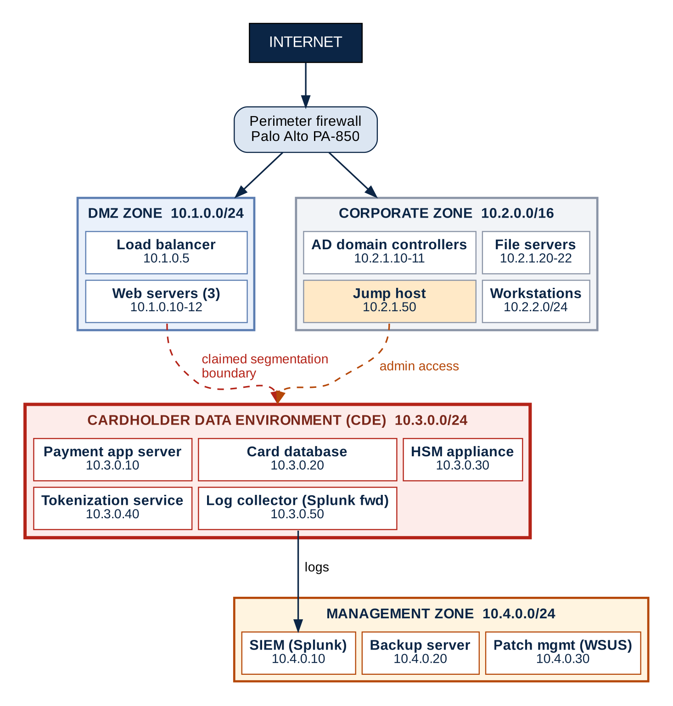

# PCI DSS Network Segmentation Review

**A GRC portfolio project: testing whether a company's network segmentation really reduces PCI DSS scope.**

> [!NOTE]
> This is a portfolio exercise based on a **fictional scenario** (Progress Commtech). It is not a real client engagement and does not state that any organization is PCI DSS compliant.

**Author:** Devavrat Yadav

## The question

Progress Commtech is an e-commerce platform provider handling about 4 million card transactions a year. Management believes its network is segmented so that only a small Cardholder Data Environment (CDE) falls under PCI DSS. This project treats that belief as a **risk claim that must be defended with evidence**, and tests whether it holds up under a QSA's scrutiny.

## Conclusion

On the documented evidence, the segmentation **cannot yet be relied on to reduce PCI DSS scope**. None of management's four segmentation claims is fully supported (two are unsupported, two are partly supported). Overall assurance rating: **High risk** (preliminary, based on documentation review).

<p align="center"><br><em>Current-state architecture as documented, with the claimed segmentation boundary</em></p>

## Key findings

| ID | Finding | Severity |
| --- | --- | --- |
| F-09 | CDE is defined by subnet, not data flow; card numbers enter through DMZ web servers outside the labeled CDE | 🔴 **Critical** |
| F-05 | Broad corporate /16 and no enforceable inter-zone rules shown | 🔴 **Critical** |
| F-01 | Shared corporate Active Directory may undermine isolation | 🟠 **High** |
| F-02 | Administration concentrated on one jump host in the corporate zone | 🟠 **High** |
| F-04 | Backup chain may hold card data outside the CDE | 🟠 **High** |
| F-06 | Shared management tools (patching, EDR, scanning) can reach the CDE | 🟠 **High** |
| F-03 | Logging pipeline may receive card data | 🟡 **Medium** |
| F-07 | Tokenization treated as an automatic scope reduction | 🟡 **Medium** |
| F-08 | Outbound connections and third-party access not shown | 🟡 **Medium** |

## What the project covers

| Phase | Output |
| --- | --- |
| 1. Define the true CDE boundary | Data flow diagram and provisional scope classification |
| 2. Examine trust relationships | Trust relationship matrix with risk ratings |
| 3. Identify segmentation weaknesses | Gap analysis with nine detailed findings |
| 4. Anticipate QSA challenges | QSA question bank and evidence requirements |
| 5. Document scope determination | Scope determination structure and exclusion register |

It also includes a target-state architecture, a remediation roadmap, a residual risk register, and an 86-question assessment questionnaire.

## Read the full report

- **[Full report (Markdown)](docs/PCI_DSS_Network_Segmentation_Review.md)** for reading on GitHub
- **[Full report (Word)](docs/PCI_DSS_Network_Segmentation_Review.docx)** for reading offline or printing

## Repository structure

```text
.
├── README.md                                   Summary (this file)
├── docs/
│   ├── PCI_DSS_Network_Segmentation_Review.md  Full report
│   └── PCI_DSS_Network_Segmentation_Review.docx Word version
└── images/                                     Diagrams used in the report
```

## Skills demonstrated

Scoping and segmentation analysis against PCI DSS, trust relationship and data flow analysis, risk rating, audit and QSA readiness, evidence planning, and writing for both technical and management audiences.

## Limitations

Findings are preliminary and based on a documented architecture only. No live configuration, firewall rules or traffic were examined. All IP addresses, hosts and products are illustrative.
